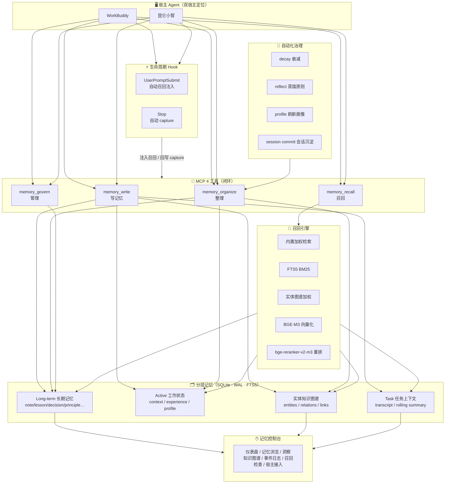

# 🍃 LeafMem

> 面向 AI Agent 的分层长期记忆引擎 —— 让 Agent 写得下、理得清、召得回，最终用记忆高效完成任务。

<p align="center">
  
  
  
</p>

很多记忆方案最终退化成"全部聊天记录"或"一份滚动摘要"，两者都会在规模上来后失真。LeafMem 选择不同的路：按**用途**分层——长期知识、当前工作状态、任务推进过程、实体关系各自独立存储，再由召回引擎按需拼装成一段可注入提示的上下文。整套系统服务于一个闭环：

> **Agent 写记忆 → Agent 整理记忆 → 人 + Agent 共同管理 → 召回记忆指导任务**

四层不是堆在一起，而是各司其职：长期记忆负责"记住"，active 负责"此刻在做什么"，任务上下文负责"这件事推进到哪了"，实体图谱负责"谁和什么有关系"。

---

## 📖 目录

1. [系统介绍](#-一系统介绍) —— 架构、四大 MCP 工具、分层记忆、自动化任务、纪律文件、主动加载通道
2. [安装与升级](#-二安装与升级) —— 引导你的 Agent 完成安装 / 升级
3. [使用说明](#-三使用说明) —— 用户怎么用、Agent 怎么用
4. [基准测试](#-基准测试)
5. [文档索引](#-文档索引)

---

## 🧭 一、系统介绍

### 1.1 整体架构



**这套分层带来三个实际收益**：

- **写入有边界**：每条记忆带着 scope（对谁可见）、kind（是什么类型）、来源与标签落库，不会把一次性的聊天内容混进长期知识；
- **召回能讲清楚**：每条命中都能解释"为什么被选出来"（词法/向量/图谱/时效各打多少分），也都能点开看原文与来源；
- **共享不失真**：WorkBuddy 和昆仑小智可以共用同一个记忆池，但每条记忆仍保留它最初是谁、在哪个场景写下的标记。

### 1.2 四大 MCP 工具（闭环）

LeafMem 把记忆操作收敛为**四个面向闭环环节**的工具，每个工具内部再按 `action` 细分：

| 工具 | 环节 | action | 说明 |
|------|------|--------|------|
| `memory_write` | ✍️ 写记忆 | `remember` / `commit` / `task_append` / `active_distill` | 写入记录、提交会话沉淀、追加任务条目、蒸馏 active |
| `memory_recall` | 🔎 召回 | `recall` / `search` / `get` / `list` / `task_window` / `active_get` | 组装召回上下文、检索、读单条/列表、任务窗口、读 active |
| `memory_organize` | 🧹 整理 | `prepare` / `apply` / `reflect` / `profile` / `decay` / `calibrate` / `rebuild` | 维护、蒸馏原则、刷新画像、衰减、experience 校准重建 |
| `memory_govern` | 👥 管理 | `update` / `delete` / `attribute` / `pin` | 更新/删除记录、归因召回价值、固定防衰减 |

> 💡 这四个工具就是 Agent 与 LeafMem 交互的全部入口。安装器会把使用纪律注入宿主的指令文件，Agent 读到后就知道何时调用。

**工具背后的子组件**（每个工具由它们协同完成）：

| 子组件 | 作用 | 参与的工具 |
|--------|------|-----------|
| Proposal Extractor | 从对话/会话蒸馏出"值得记住"的提案 | write（commit） |
| Entity Extractor + Entity Store | 抽取实体（人/项目/技术/工具/组织）、建实体间关系与实体-记忆链接，构成知识图谱 | write（remember/commit 时自动建链）、recall（图谱加权） |
| Active Memory Manager | 维护 context / experience / **profile（用户画像）** 三类压缩文档；**profile 会注入每次召回** | recall（active 层）、organize（profile/distill） |
| Task Context Manager | 任务 transcript、rolling summary、决策窗口 | write（task_append）、recall（task_window） |
| Maintenance Manager | reflect（蒸馏原则）、calibrate/rebuild（experience）、attribute（归因） | organize、govern |
| Inspect Event Store | 写/改/删/召回的持久化审计事件 | 全部（自动） |

### 1.3 分层记忆模型

| 层 | 内容 | 特征 |
|----|------|------|
| **Long-term** 长期记忆 | 持久记录，带 `scope`/`kind`/`source`/`tags`/`confidence`/`importance`/`metadata` | 可跨 Agent 共享，保留来源与标记 |
| **Active** 工作状态 | `context`（当前上下文）/ `experience`（可复用经验）/ `profile`（用户画像） | 压缩、随治理更新 |
| **Task** 任务上下文 | transcript 条目、rolling summary、决策 | 按 taskId 聚合 |
| **Entity** 实体图谱 | `entities` / `entity_relations` / `entity_links` | 支撑召回加权与控制台可视化 |

**Scope 体系**（一条记忆"对谁可见"的标记，写入时自动带上）：

**日常使用只有一个正确 scope 类型：`agent:<宿主>`（具体是哪个宿主 scope，取决于安装配置）。**

- **共用拓扑**（双宿主都装了时推荐）：统一落**主 scope**。主 scope 按固定优先级解析——两个宿主都配置时为 `agent:workbuddy`（WorkBuddy 优先），只有昆仑小智时为 `agent:kunlunxiaozhi`。两宿主共用一个记忆池，互相可见可写——这是"共用一套记忆"的实现方式，而不是写 `user:` scope；
- **分拆拓扑**：各落各的（`agent:workbuddy` / `agent:kunlunxiaozhi`），互不可见；
- **单宿主安装**：只装哪个宿主就只有那个 scope，天然单一记忆池，无共用/分拆问题。

其余六种（`user` / `task` / `session` / `document` / `project` / `repo`）都是**面向 SDK 编程接入的预留维度**（多用户 SaaS、按任务/仓库隔离等场景），双宿主日常使用**不应出现**：

- 任务工作态数据存在专门的「任务上下文」层（task_context 表），不是 `task:` scope 的记忆——任务页里的任务 scope 全部是 `agent:<宿主>`；
- 用户画像存在 Active 层（profile 文档），不是 `user:` scope 的记忆。

> 控制台「范围」选择器是动态的：默认「全部记忆」（不过滤），并列出实际有内容的 scope。正常运行时这里应该**只有你已安装宿主的 agent scope**（单宿主 1 个；双宿主共用 1 个主 scope；双宿主分拆 2 个）。如果出现 `user:` / `task:` 等其他类型，说明有历史错误记录需要修复（运维哨兵会检查并告警）。

### 1.4 召回引擎

`memory_recall(action=recall)` 组装的是**四层上下文**：

1. **active 层** —— 用户画像 + 当前 context + experience（画像已注入，保证蒸馏知识真正参与）
2. **navigation 层** —— 命中的记忆导航
3. **task 层** —— 任务窗口（如有 taskId）
4. **palace/retrieval 层** —— 加权检索结果

加权信号：**词法重叠 + hash 向量 + 实体图谱加权 + FTS5 BM25 + recency + importance + principle 加成**，过期记录自动降权。**BGE-M3 向量化 + bge-reranker-v2-m3 重排为默认配置**：安装引导默认帮你配好（硅基流动免费额度即可，无需付费），开启后 LongMemEval R@10 从 93.4%（内置）提升到 98.2%（2026-10-22 重测，见[基准测试](#-基准测试)）；不配任何 Key 也能用内置检索运行，只是精度按基准表"内置"一行的水平。

**蒸馏与画像默认免费**：reflect 蒸馏原则、profile 画像刷新由 `leafmem-maintenance` 运维技能驱动**宿主模型**完成，不需要任何额外 API Key（见 1.5）。SDK 编程接入场景另可在代码里给 `createLeafMem` 传自定义 inferencer 函数（见 [`docs/USAGE.md`](docs/USAGE.md)）；不配置时蒸馏降级关闭，核心召回不受影响。

### 1.5 周期性维护（leafmem-maintenance 运维技能）

记忆整理**不需要额外付费 API Key**——由宿主模型通过 MCP 完成。LeafMem 提供 `leafmem-maintenance` 运维技能（随仓库 `ops/skills/` 分发），配合每周自动化任务执行完整 SOP：

| 步骤 | 内容 | LLM 依赖 |
|------|------|---------|
| 健康检查 | MCP 状态 / 存储容量 / canary 召回验证 | 无 |
| 全量存档 | 删除前强制导出 JSON 存档 | 无 |
| 真重复合并 | 内容 SHA256 哈希检测（禁止前缀聚类） | 无 |
| 碎片整合 | 同日期+同 context ≥3 条簇 → 整合九规则 | 宿主模型 |
| 原则蒸馏 | 同标签 lesson 聚类 → principle（reflect 宿主版） | 宿主模型 |
| 画像刷新 | preference delta → profile sections 更新（profile 宿主版） | 宿主模型 |
| 衰减降权 | `memory_organize(action=decay)` | 无 |
| 镜像同步 | ops/mirror-sync.js 导出全量记忆 | 无 |

**现成的自动化提示词模板**（随仓库/包分发，宿主读取即可创建定时任务；安装引导会把两者都建成，不是可选项）：

| 模板 | 节奏 | 作用 |
|------|------|------|
| `ops/automations/weekly-maintenance.md` | 每周一 04:00 | 深度整理（自动加载本技能）+ 周度观察（`ops/observation.py --mode weekly` 采集治理指标 + 周环比五项判断 + 周报） |
| `ops/automations/daily-sentinel.md` | 每日 10:00 | 只读健康哨兵（含误删检测 + hook 心跳检查），异常才提醒 |

两者分工明确：深度整理每周一次（记忆增量 ~20-50 条/周，每日无料可整；语义整理是宿主模型的 LLM 重活，每周节奏成本可控），并随整理做周度趋势观察；哨兵每日只读巡检（不整理、零写入、零成本，仅报异常）。

### 1.6 纪律文件与生命周期 Hook（0.3.0 双保险）

安装器会向宿主写入记忆使用纪律（recall-first、写入规范、scope 铁律等）。对 WorkBuddy 系宿主，纪律块**置顶写入 `SOUL.md`**（H1 标题之后，优先级高于其他行为规则；MEMORY.md 保持纯记忆存储）。同时读取导入用户本地的 SOUL / USER / MEMORY / IDENTITY / AGENTS / SYSTEM.md 全部既有记忆文件，作为初始导入与初版用户画像的原料。

**Hook 架构（本版本核心特点）**：除了纪律规则，安装器还会把生命周期 hook 注册进宿主 `settings.json`：

- **UserPromptSubmit** → 自动调用 LeafMem 召回相关记忆，注入当前上下文（模型无需记得"先 recall"）；
- **Stop** → 回合结束时自动 capture 本轮要点（显式"记住"请求、偏好等），不再依赖模型收尾时自觉 commit。

这解决了纯规则模式下 `task_append` 不触发、commit 时机不可控的老问题——**记忆的写入与召回由机制保障，而非依赖模型自觉**。桥脚本零依赖、失败静默、心跳写 `~/.leafmem/hooks.log`；宿主不触发 hook 时自动降级回 SOUL.md 规则路径，两条路互为保险。

> 🔒 **纪律铁律**：写入时 `importance`/`confidence` 必须是数字而非字符串；`tags` 是扁平数组。违反会被拒收。

### 1.7 自动化记忆通道：CLI-first（0.3.21）

**问题背景**：自动化/定时会话中 `mcp__leafmem__*` 工具**恒不可用**——一次性自动化实测（2026-09-04，5.5.1 与 5.5.3 一致）直连调用返回 absent：宿主把自定义 MCP 工具塞进 deferred 索引后寻址失效，既不能直连也无法经 ToolSearch 发现。交互会话直连正常，两条路径的工具注册机制不同。**宿主行为不可控，自动化必须把独立通道作为主通道，而不是降级备胎。**

**leafmem-cli**：安装/升级时自动部署到 `~/.leafmem/leafmem-cli.sh`，封装 launchd 常驻 agent service（127.0.0.1:3377）的 HTTP API，与宿主 MCP 工具注册完全解耦。字段面对齐 HTTP 路由全集（tags/confidence/source/metadata/kinds/cursor 均支持）：

```bash
~/.leafmem/leafmem-cli.sh health                       # 探活
~/.leafmem/leafmem-cli.sh recall "查询内容" [maxChars] [--task-title t] [--tool-context c]
~/.leafmem/leafmem-cli.sh remember "内容" [summary] [kind] [importance] \
    [--tags "a,b"] [--confidence n] [--source s] [--metadata JSON]
~/.leafmem/leafmem-cli.sh get|delete <id>              # 读 / 删单条
~/.leafmem/leafmem-cli.sh update <id> [--summary s] [--tags "a,b"] [--metadata JSON] ...
~/.leafmem/leafmem-cli.sh list [limit] [kinds] [--tags "a,b"] [--cursor c]
~/.leafmem/leafmem-cli.sh stats | scopes               # 统计 / scope 分布
~/.leafmem/leafmem-cli.sh task-detail <taskId>         # 任务窗口
~/.leafmem/leafmem-cli.sh commit-summary "摘要"        # 会话摘要捕获
~/.leafmem/leafmem-cli.sh inspect-recall "查询"        # 召回调试（分层诊断）
```

**自动化 CLI-first 纪律**（已写入 SOUL 模板，新安装/升级自动获得）：自动化会话读写 LeafMem **首选 leafmem-cli**；`mcp__leafmem__*` 恰在函数表时可顺带直调，但其缺席是**预期行为**而非故障，不得静默重试或判异常；CLI 不可达时先查 launchd 服务与 `~/.leafmem/agent-service.json`，最后才降级宿主会话搜索（只读）。

> 写/删默认落 `agent:<scopeId>` scope（URL `?scope=` 参数）；`task_append` 无直接 HTTP 路由，用 `remember` + metadata.taskId 近似；tags 逗号分隔，metadata 传 JSON 对象字符串。

---

## 🚀 二、安装与升级

LeafMem 的安装/升级**优先由你的 Agent 引导完成**——你只需要对 Agent 说一句话，它会引导你配置 API Key、完成 MCP 接入。

**分发方式：GitHub Releases 附件包（解压即用）**。dist 零运行时依赖（仅 Node 内置模块），下载解压后由 Agent 按引导文件执行安装，**全程不需要 npm**（国内访问 npm 慢，故不走 npm 安装路径；npm 上的同名包仅作归档）。

### 2.1 通过 Agent 安装（推荐）

1. 从 [GitHub Releases](https://github.com/xdragonjia/leafmem/releases) 下载最新 `leafmem-<version>.zip`，解压到任意目录。
2. 把解压目录连同下面对应的引导语发给你的 Agent：

#### 2.1.1 给昆仑小智用户的引导语（macOS / Windows）

> 请帮我安装并配置 LeafMem 记忆引擎。安装引导文件就在本 releases 包解压目录内的
> `INSTALL-KUNLUNXIAOZHI.md`。请完整读取该文件，严格按其中「昆仑小智执行步骤」
> 逐条执行；需要我手动操作的（安装 Node.js、提供硅基流动 API Key、点击 MCP 信任）
> 请明确提示我。安装完成后按文件末尾的自检清单逐项验证，并把结果告诉我。

昆仑小智会读取引导文件自动完成安装器运行、向量化配置、MCP 信任引导、服务自启、维护技能与自动化、初始导入、初版用户画像与生命周期 hook 注册；用户全程只需装 Node.js、给一枚硅基流动 Key、点一次 MCP 信任、最后重启一次宿主。

#### 2.1.2 给 WorkBuddy 用户的引导语（macOS / Windows）

> 请帮我安装并配置 LeafMem 记忆引擎。安装引导文件就在本 releases 包解压目录内的
> `INSTALL-WORKBUDDY.md`。请完整读取该文件，严格按其中「WorkBuddy 执行步骤」
> 逐条执行；需要我手动操作的（安装 Node.js、提供硅基流动 API Key、点击 MCP 信任）
> 请明确提示我。安装完成后按文件末尾的自检清单逐项验证，并把结果告诉我。

WorkBuddy 同上：引导文件驱动全流程，含初始导入（读本地 SOUL/USER/MEMORY/IDENTITY/AGENTS/SYSTEM.md 入记忆库）与初版用户画像生成。

### 2.2 命令行安装（手动）

```bash
# 单宿主（在解压目录内执行）
node dist/bin/leafmem-agent.js install workbuddy
node dist/bin/leafmem-agent.js install kunlunxiaozhi

# 全部宿主 + 指定记忆拓扑
node dist/bin/leafmem-agent.js install all --memory shared   # 双宿主共用一池
node dist/bin/leafmem-agent.js install all --memory isolated # 各自独立 scope
```

一条 `install` 命令完成五件事：写 MCP 配置（合并保留已有 env）、**初始导入本地记忆文件**、纪律块置顶写入 SOUL.md、注册生命周期 hook、（all 时）安装控制台服务。

支持的宿主：

```text
workbuddy | kunlunxiaozhi | all
```

所有宿主默认指向同一个 SQLite：`~/.leafmem/memory.sqlite`

### 2.3 通过 Agent 升级（推荐）

下载新版 release 包解压后，对 Agent 说：

> **“帮我用这个新包升级 LeafMem 到最新版本。”**

Agent 会在新解压目录内运行 `update`，幂等地刷新各宿主的 MCP 配置、纪律注入、生命周期 hook 与服务自启，无需 git/npm。若工具接口变更，Agent 会提醒你**重新到 MCP 管理页点信任**。记忆库（SQLite）不受影响、不会被删除。

### 2.4 命令行升级

```bash
# 在新解压目录内执行（release 安装无 git，自动跳过代码刷新，直接幂等重装）
node dist/bin/leafmem-agent.js update all
node dist/bin/leafmem-agent.js update workbuddy
```

### 2.5 控制台与本地服务

```bash
# 启动浏览器控制台
node dist/bin/leafmem-agent.js ui

# 管理常驻服务
node dist/bin/leafmem-agent.js service install
node dist/bin/leafmem-agent.js service status
node dist/bin/leafmem-agent.js service url

# 终端版
node dist/bin/leafmem-agent.js tui
```

### 2.6 API Key 快速上手

LeafMem 开箱即用（不配任何 Key 时用内置检索工作）。在此基础上，安装引导会自动帮你配好完整的检索栈：

- **向量化 + 重排**：硅基流动 BGE-M3（embedding）+ bge-reranker-v2-m3（rerank），免费额度即可，显著提升召回精度
- **蒸馏/画像**：由运维技能用宿主模型完成，免费，无需任何额外配置

配置细节见 [`docs/GETTING_STARTED.md`](docs/GETTING_STARTED.md)。

---

### 2.7 环境变量总表

所有配置项都以 `LEAFMEM_` 前缀，读取一律走 `leafmemEnv()`（见 `src/system/env-compat.ts`）。

#### 路径与作用域

| 变量 | 默认 | 作用 |
|---|---|---|
| `LEAFMEM_HOME` | `~/.leafmem` | 数据目录（`memory.sqlite` / `agent-service.json` / `hooks.log` 都在这里） |
| `LEAFMEM_STORAGE_PATH` | `$LEAFMEM_HOME/memory.sqlite` | 库文件路径 |
| `LEAFMEM_SCOPE_TYPE` / `LEAFMEM_SCOPE_ID` | `agent` / 宿主名 | 默认写入作用域 |
| `LEAFMEM_ENTITY_VOCAB` | 内置 | 实体受控词表路径（热加载，改文件不用重启） |
| `LEAFMEM_WORKBUDDY_HOME` / `LEAFMEM_AGENT_HOME` / `LEAFMEM_HERMES_HOME` / `LEAFMEM_OPENCLAW_HOME` | — | 宿主目录覆盖（双宿主安装用） |

#### 检索后端

| 变量 | 默认 | 作用 |
|---|---|---|
| `LEAFMEM_RETRIEVAL_BACKEND` | `builtin` | `builtin`（内置打分 + 可选远程向量/重排）或 `qmd` |
| `LEAFMEM_QMD_COMMAND` | — | `qmd` 后端的可执行命令 |
| `LEAFMEM_EMBEDDINGS_PROVIDER` / `MODEL` / `BASE_URL` / `API_KEY` | 无 | 远程 embedding（默认建议 BGE-M3 / 硅基流动） |
| `LEAFMEM_RERANK_URL` / `MODEL` / `API_KEY` / `TIMEOUT_MS` | 无 / — / 3000 | 交叉编码器重排（建议 bge-reranker-v2-m3） |

#### 打分调优（v0.3.24 起，默认值已按实测调优）

| 变量 | 默认 | 作用与依据 |
|---|---|---|
| `LEAFMEM_LEXICAL_LEN_NORM` | **`sqrt`** | 词法长度归一。`off` 恢复旧行为。原实现是「查询覆盖率」，长文档恒得满分（5,100 字记录 `lexical=1.000`） |
| `LEAFMEM_PRINCIPLE_BOOST_MODE` | **`tiebreak`** | `flat`=旧行为（`kind=principle` 无条件 +0.1）/ `off`=不加 / `tiebreak`=分差 ≤0.01 时才优先 |
| `LEAFMEM_SECTION_BOOST` | **`0.2`** | section/aliases 的 3-gram 短语命中加成；`0` 关闭 |
| `LEAFMEM_RERANK_TOP_K` | **`20`** | 每次送入重排的候选数（原 40）。实测 20 的质量不降、p50 少 700ms |
| `LEAFMEM_RERANK_DOC_CHARS` | **`4000`** | 送入重排的每篇文档截断长度（原先整篇送）。实测截断越狠质量越差，4000 是饱和点 |
| `LEAFMEM_STATUS_PAGE_MAX` | **`0`（关）** | 状态页目录注入上限。`0`＝不注入；设 `12` 恢复注入（每条约 640 字上下文，实测对检索指标无影响，见 §3.7） |

> 🔴 **升级注意**：上面 5 项默认值相对 0.3.23 有变化，检索排序会变。需要完全恢复旧行为，把前三项分别设为
> `off` / `flat` / `0`。

#### 诊断

| 变量 | 默认 | 作用 |
|---|---|---|
| `LEAFMEM_TIMING` | 关 | `1` 时每次 recall 输出一行分阶段耗时：`palaceRecall / retrievalRecall / activeBlocks / taskWindow / navigation / statusPages / assemble` |
| `LEAFMEM_INFERENCER` | 无 | 写入时的 LLM 推断器（去重评估/摘要），不配则走阈值去重 |

---

## 📚 三、使用说明

LeafMem 的使用分两类场景：**用户日常触发** 与 **Agent 自主使用**。

### 3.1 用户怎么用

你不需要记命令，只需在对话里用自然语言触发：

| 你想做什么 | 对 Agent 说 | Agent 实际调用 |
|-----------|------------|---------------|
| 让它记住一件事 | “记住：以后先给结论再给证据” | `memory_write(action=remember)` |
| 回忆之前的决定 | “我们之前是怎么定 X 方案的？” | `memory_recall(action=recall)` |
| 改一条记忆 | “把那条偏好改成简洁英文回复” | `memory_govern(action=update)` |
| 删一条记忆 | “删掉那条过时的记录” | `memory_govern(action=delete)` |
| 保护重要记忆 | “把这条原则固定住，别被衰减” | `memory_govern(action=pin)` |
| 主动整理 | “整理一下最近的记忆” | 加载 `leafmem-maintenance` 技能执行整理 SOP（宿主模型驱动，免费）；`memory_organize(action=decay)` 可直接用 |
| 看任务工作态 | “这个任务之前做到哪了？” | `memory_recall(action=task_window)` 或控制台任务页 |

#### 记忆控制台

打开 `http://127.0.0.1:3377/console`（或 `leafmem-agent ui`），功能：

| 页面 | 作用 |
|------|------|
| 📊 仪表盘 | 记忆总数、蒸馏原则、召回次数、类型/来源分布、最近活动 |
| 📖 记忆浏览 | 检索、筛选（类型/来源/标签）、查看、删除记录 |
| 💡 洞察 | 蒸馏原则列表、用户画像 |
| 🕸️ 知识图谱 | 实体关系力导向图（预模拟稳定布局、邻接高亮、点击详情） |
| ⏱️ 事件日志 | 写/改/删/召回的审计流水 |
| 🔎 召回检查 | 模拟 Agent 检索，看实际召回了什么 |
| 📋 任务上下文 | Agent 工作态（transcript + rolling summary），分页浏览、点开看详情；与记忆是两套数据 |
| 🔌 宿主接入 | 双宿主状态卡片：已配置→「修复」（重检测修复 MCP/指令漂移），未配置→「配置」；共用记忆开关（四层共享说明） |
| ❓ 帮助文档 | 本文档，支持目录跳转与全文搜索（mermaid 图实时渲染） |

### 3.2 Agent 怎么用

安装器已把纪律注入宿主，Agent 按以下闭环自主运行：

#### ① 写记忆（`memory_write`）

- **recall-first**：回答前先 `memory_recall(action=recall)`，除非请求完全自包含
- **remember**：用户表达持久偏好/工作规则 → `memory_write(action=remember)`，可省略 scope（默认落当前宿主）
- **commit**：重要工作完成或会话收尾 → 宿主先用自己的模型蒸馏 `rollingSummary`，再 `memory_write(action=commit)`，并附带 `activeContext`/`activeExperience`

#### ② 整理记忆（`memory_organize`）

| action | 作用 |
|--------|------|
| `reflect` | 同标签 lesson/decision 聚类蒸馏为 `principle`（节流，内部判断到期） |
| `profile` | 基于 preference/identity delta 更新用户画像（只改 LLM 输出的 section） |
| `decay` | 陈旧未召回的低重要性记忆降权（pinned 豁免，不删除） |
| `prepare` / `apply` | 宿主中介式 active 维护：prepare 生成请求，apply 落库 |
| `calibrate` / `rebuild` | experience 校准 / 重建 |

#### ③ 管理记忆（`memory_govern`）

- `update` / `delete`：用户要求修正或删除时（需显式 scope）
- `attribute`：某条被召回的记忆**真的指导了工作**后，归因加权
- `pin`：固定重要记忆防衰减

#### ④ 召回（`memory_recall`）

- 组装 active + navigation + task + palace 四层上下文（active 层含用户画像）
- `search` / `get` / `list` 返回完整记录；`recall` 返回 prompt-ready 文本（record 内容已并入 injectedContext）

#### ⑤ 实体图谱与审计（自动，无需手动调用）

- 每次 `remember`/`commit` 自动抽取实体并建链，召回时图谱参与加权；控制台"知识图谱"页可视化
- 每次写/改/删/召回自动写审计事件，控制台"事件日志"页可查

### 3.3 纪律文件使用约定

- **scope 铁律**：默认 scope 由 mcp.json 注入（如 `agent:workbuddy`），写入时不传 scope；必须指定时用当前宿主 scope
- **召回省略 scope**：跨 Agent 召回共享记忆时不传 scope，让 LeafMem 搜共享池
- **参数类型**：`importance`/`confidence` 是数字；`tags` 是扁平数组（XML 逐项）

### 3.4 实体抽取与受控词表（v0.3.23 起）

写入记忆时引擎自动抽取实体建知识图谱（控制台"知识图谱"页可见）。抽取判据（宁缺毋滥，实体错误比缺失更有害）：

| 通道 | 判据 | 说明 |
|------|------|------|
| ① 受控词表（最高优先） | `~/.leafmem/entity-vocab.json` 命中即建 | 词表由宿主维护；**≤2 字中文名只在 @mention 形态命中**（防"国王健康椅"误抽"王健"类子串误命中），≥3 字名裸文本即命中 |
| ② @mention | 三重拦截后建 person | 噪声词表（字段名/标签词）+ 形态正则（时长/编号）+ 通用停用词；person 似然判据=中文 2-4 字 / 首大写英文 / 小写单词 |
| ③ 包名/命名空间形态 | 下划线多段小写 → kind=`namespace` | 如 npm scope、平台账号 ID，不冒充 person |
| ④ 域名形态 | → kind=`org` | 如 qq.com |
| ⑤ 引号串/PascalCase | → project / tech | 仅默认模式（非 strict） |

**外部权威源增强（宿主集成模式）**：词表文件是 LeafMem 预留的增强接口——宿主可把自己的权威实体库（如知识图谱中来自结构化登记的人员/组织）导出为词表条目（`source: graph_authoritative`），使记忆抽取直接被权威源校准，而不是只靠文本启发式。词表在服务启动时加载，更新后需重启服务生效。同名冲突时宿主应保证权威源覆盖启发式条目。

### 3.5 记忆链接、召回保温与取代（v0.3.24 起，2026 开源记忆系统借鉴）

三个借鉴自 A-MEM（NeurIPS 2025）/ Zep / Retrieval-Driven Reconsolidation 的存储-演化特性：

| 特性 | 机制 | 用户/Agent 视角 |
|------|------|----------------|
| **记忆间链接** | `memory_links` 表（区别于 entity_links 的记忆-实体链接）：同主题 same_topic / 取代 supersede 等关系 | 召回命中记忆时，其链接邻居以「🔗 关联记忆」块自动附在注入上下文尾部（不占 hits 配额） |
| **召回保温** | recency 评分取 updatedAt 与 lastRecalledAt 的较新者 | 常被召回使用的记忆自然保温，不再只按写入时间衰减（人类记忆特性，零成本） |
| **supersede** | `memory_govern(action=supersede, id=旧, supersededBy=新)`：旧条链新条+降权，**不删除**（invalidate-don't-delete，历史可查） | 记忆被新裁定取代时用此动作，召回旧条会标注已被取代并指向新条 |

**建链策略（成本纪律）**：引擎不在写入时调 LLM 建链（2026 调研点名的成本陷阱：每条新记忆 k 次 LLM 调用）。宿主按自己的节奏建链：规则建链（如共享标签≥2→same_topic）每日跑，LLM 判断建链/记忆演化（A-MEM evolution）每周低频跑。链接表由引擎在 recall 时消费，旧库无表时静默降级（fail-open）。

**受控词表热加载**：`entity-vocab.json` 按 mtime 检测变化，更新词表**无需重启服务**，下一条记忆写入即生效（见 3.4 词表增强通道）。

---

### 3.6 每日日志回流（ops/ingest-daily-logs.py）

把工作日志（`YYYY-MM-DD.md`）增量回流进记忆库，供 recall / 图谱 / 周维整复用：

```bash
python3 ops/ingest-daily-logs.py --dry-run                      # 先看会入什么
python3 ops/ingest-daily-logs.py --source work=~/notes/daily    # 指定源目录
python3 ops/ingest-daily-logs.py --selftest                     # 只跑分块无损自检
python3 ops/ingest-daily-logs.py --rebuild-state                # state 丢失后从库内自愈
```

- 按 `## ` 节切分，只收日期命名文件
- **结构分块（v3）**：段落 / 列表 / 表格 / 代码块为天然边界（表格与代码块原子不切），超长再按句边界细分；目标 900 字、下限 350、硬上限 5200。**不做 embedding 语义分块**——NAACL 2025 实证其成本换不来稳定收益，且易过碎
- **面包屑标题前缀写进正文**：`[2026-10-21·节标题·2/7]`，向量与词法两路检索都能命中标题词（Anthropic contextual retrieval 同族做法，零 LLM 成本）
- **父块锚点**：metadata 带 `source_file / section / chunk{seq,span,chars,continued}`，命中小块可回读整节或原文区间
- **无损不变量**：所有块正文按序拼接（去空白）必须与原文逐字符相等，`--selftest` 对全部源文件断言；不通过则该节跳过写库并报错
- **增量按字符偏移续写**：节尾追加只入新增区间，块尾天然落在结构/句边界；块指纹（`state.seen`）吸收回退重叠
- **写入传 `dedupe:false`**：分块摄入按块精确幂等，服务端 0.85 模糊合并会把同节兄弟块（实测相邻块相似度均值 0.647、极值 0.917）覆盖成一条
- 状态文件默认 `~/.leafmem/daily-ingest-state.json`，只在写入成功后才记账（失败下轮重试）；**state 缺失时脚本拒绝运行**（防整批重导），可先 `--rebuild-state` 从库内 metadata 反推

### 3.7 状态页（memory status pages，v0.3.24 引入，当前**默认关闭**）

> 🔴 **当前状态（2026-10-22 实测后调整）**：这套机制**默认不启用**，也不随周检自动生成。
> 原因：把库内 10 条状态页全部下线后重跑同一套 41 题 golden 评测，
> core R@1 28/28、R@8 38/38、retrieval R@1 31/31、R@8 39/39、MRR 0.827 vs 0.828 —— **逐项相同**，
> 即对「回答原始问题」的检索贡献为 0；同时 `recallCount` 显示这些页从未被真实召回。
> 它的唯一可量化价值是把 3.1 条源记忆（约 2,160 字）压成 1 条约 270 字（7.9 倍压缩），
> 属于「低频状态查询」的预生成缓存。**若你确认自己的场景是"经常问某件事现在怎么样了"，再按下面方式手动启用。**
>
> 保留而非删除的理由：① 机制本身（结论先行 + 问题式标题 + 溯源 + 演化指针）经实测有效
> （陈述式标题命中 0/3，问题式 3/3）；② `source_refs` 与知识系统资产契约同构；
> ③ 一旦出现高频状态查询场景可直接复用，不必重写。

这类问题（进展/状态/跑到第几批）靠纯检索经常答不准——因为**问句的谓词与记录的谓词不同词**
（问"有没有成功"，记录写"ok:true"）。状态页是把流水记忆压成**可检索的状态答案**的轻量机制，**不是独立的信念层**：
它就是普通记忆，复用现有检索链。

**形态**

| 字段 | 值 |
|---|---|
| `kind` | `experience` |
| `metadata.kindOfSnapshot` | `weekly-status`（用于识别与目录注入） |
| `metadata.section` | **问题式标题**（如「备份有没有成功」）——实测陈述式标题命中 0/3，问题式 3/3 |
| `metadata.aliases` | 3 个不同**措辞粒度**的问法（正式 / 口语 / 领域词）——换词才有用，换语序无用 |
| `metadata.supports` | 支撑本结论的源记忆 id 列表（禁编造，写入前机械校验） |
| `metadata.source_refs` | 与知识系统资产契约同构的 `[{doc_id,title,modified_at,anchor}]`，供跨系统消费 |
| 正文 | 结论先行（正常/已完成/进行中/阻塞…）+ 关键数字 + 要不要处理 |

**检索如何吃到它**：`section` 与 `aliases` 一起参与 3-gram 短语匹配（`LEAFMEM_SECTION_BOOST`）。

**目录注入默认关闭**：原设计会把 active 状态页标题作为短目录塞进 `stableContext`（最多 12 条、60s 缓存）。
2026-10-22 实测该注入对 41 题检索指标零影响、且占用每次请求的上下文，故默认关闭
（`LEAFMEM_STATUS_PAGE_MAX` 默认 `0`；需要时设为 `12` 打开，实测注入约 640 字 / 10 条）。

**演化（不重写旧内容）**：同一主题出新一期 → 旧一期标 `status=superseded` + `supersededBy`，
正文一字不改（符合 invalidate-don't-delete）。同一主题的判定优先用模型显式给的 `supersedes`
（支持 8 位以上唯一前缀），否则回落到**问题式标题的 3-gram 覆盖率 ≥0.6**——
不用 topic 字符串（LLM 每期生成的 topic 名不稳定）。

**增量模式（默认开启）**：`--since N` 是滚动窗口，第 N 期的窗口会覆盖上一期的源记忆。
若不告诉模型"这些主题已归纳过"，它会把同一批主题每期重写一遍（旧版全标 superseded、
新版内容几乎相同）。因此生成时会把上一期 active 清单喂进 prompt，并对
**`supports` 里没有「上期生成之后新记忆」的重写**做机械拦截（回落沿用、不写库）。
判据用确定性信号，不信模型自述——实测它会同时给出 `reuse` 和重写（自相矛盾）。

**写入纪律**：走 HTTP API + `dedupe:false`（状态页必须独立成条，不能被 0.85 相似度合并）；
更新元数据带 `preserveUpdatedAt:true`（否则 recency 被抬高）。

生成器：`ops/status_page_gen.py`（随仓分发）。常用用法：

```bash
python3 ops/status_page_gen.py --since 7                 # dry-run，只看会生成什么
python3 ops/status_page_gen.py --since 7 --apply         # 写入 + 自动演化旧期（增量模式）
python3 ops/status_page_gen.py --since 7 --no-incremental # 关闭增量基线（全量重生成，慎用）
python3 ops/status_page_gen.py --evolve-only             # 只做同主题清理（不调 LLM）
python3 ops/status_page_gen.py --backfill-refs           # 给已有状态页补 source_refs
python3 ops/status_page_gen.py --backfill-superseded-by  # 给早期缺指针的旧页补 supersededBy
```


---

## 📈 基准测试

基线测量 2026-08-08；默认配置重测 2026-08-11；**2026-10-22 部分重测**（内置档 + LME 默认配置档；原因见文末说明）。基准的三个配置层级：

- **内置（零配置）**：不配任何 embedding / rerank 模型与 API Key，仅内置 hash 向量 + 五维加权评分；
- **+ BGE-M3 embedding（未含重排）**：在内置评分上叠加 BGE-M3 向量相似度（0.65/0.35 融合），走硅基流动免费 API；
- **默认配置 = BGE-M3 embedding + bge-reranker-v2-m3 交叉编码器重排**：安装引导配出的形态（重排对 top-40 候选与检索分 60/40 融合，fail-safe）。

完整方法与复现见 [`benchmarks/BENCHMARKS.md`](benchmarks/BENCHMARKS.md)。

| Benchmark | 检索配置 | R@5 | R@10 | NDCG@10 | 需 API Key |
|-----------|---------|-----|------|---------|-----------|
| LongMemEval (500q) | 内置（零配置） | **89.0%** | **93.4%** | **0.825** | 否 |
| LongMemEval (500q) | + BGE-M3 embedding（未含重排） | 95.8% | 97.6% | 0.916 | 是（硅基流动免费） |
| LongMemEval (500q) | 默认配置（+ 重排） | **96.8%** | **98.2%** | **0.921** | 是（硅基流动免费） |
| LoCoMo (1986q) | 内置（零配置） | **84.2%** | **92.0%** | **0.734** | 否 |
| LoCoMo (1986q) | + BGE-M3 embedding（未含重排） | 88.4% | 94.9% | 0.790 | 是（硅基流动免费） |
| LoCoMo (1986q) | 默认配置（+ 重排） | 90.3% | 95.8% | 0.819 | 是（硅基流动免费） |

> 🔴 **2026-10-22 重测说明**（加粗行为本次实测，其余为 2026-08-11 历史值）：
> 1. **LongMemEval 不可与旧数字直接比较**：`remember` 自 2026-09-11 起有单条 6,000 字上限，
>    而 LME 数据里有 15,058 字会话 ⇒ 原「1 session = 1 条记录」跑法已无法执行（旧基准实际已失效）。
>    本次按上限切块入库（更接近真实形态），记录粒度变细、R@10 更难命中，故 R@10 略降**主因是方法变化**。
> 2. **LoCoMo 方法未变**（数据无超长记录）：84.2 / 92.0 / 0.734 与旧值 84.1 / 92.0 / 0.733 持平
>    ⇒ 2026-10-22 的检索打分改动（词法长度归一、principle tie-break）在外部数据集上无实质影响。
> 3. 完整方法与逐类目分解见 [`benchmarks/BENCHMARKS.md`](benchmarks/BENCHMARKS.md)。

---

## 📂 文档索引

| 文档 | 内容 |
|------|------|
| [`docs/GETTING_STARTED.md`](docs/GETTING_STARTED.md) | API Key 配置、双宿主数据策略 |
| [`docs/USAGE.md`](docs/USAGE.md) | MCP、宿主接入、UI/TUI、导入、存储 |
| [`docs/WORKBUDDY.md`](docs/WORKBUDDY.md) | WorkBuddy 最短接入路径 |
| [`docs/ARCHITECTURE.md`](docs/ARCHITECTURE.md) | 分层设计、召回流、SQLite schema |
| [`docs/API.md`](docs/API.md) | 核心 API、4 工具、HTTP 路由 |
| [`benchmarks/BENCHMARKS.md`](benchmarks/BENCHMARKS.md) | 基准方法与完整结果 |
| [`INSTALL-KUNLUNXIAOZHI.md`](INSTALL-KUNLUNXIAOZHI.md) | 昆仑小智分步安装引导（macOS/Windows，agent 驱动，含初始导入+画像+hook） |
| [`INSTALL-WORKBUDDY.md`](INSTALL-WORKBUDDY.md) | WorkBuddy 分步安装引导（macOS/Windows，agent 驱动，含初始导入+画像+hook） |
| [`ops/hooks/leafmem-hooks.mjs`](ops/hooks/leafmem-hooks.mjs) | 生命周期 hook 桥脚本（UserPromptSubmit 召回注入 / Stop 自动 capture） |
| [`ops/build-release.sh`](ops/build-release.sh) | release 包打包脚本（解压即用 zip，绕开 npm） |

---

## 📦 包入口

```text
@xdragonjia/leafmem            # 主入口
@xdragonjia/leafmem/core       # 分层记忆核心
@xdragonjia/leafmem/mcp        # 4 工具 + stdio MCP server
@xdragonjia/leafmem/active     # Active 记忆（context/experience/profile）
@xdragonjia/leafmem/task       # 任务上下文
@xdragonjia/leafmem/entity     # 实体图谱
@xdragonjia/leafmem/retrieval  # 检索（内置/向量/QMD）
@xdragonjia/leafmem/maintenance# 治理（decay/reflect/profile）
@xdragonjia/leafmem/runtime    # 召回上下文组装
@xdragonjia/leafmem/http       # 控制台 HTTP
@xdragonjia/leafmem/adapters   # Hermes/OpenClaw 兼容
```

---

## ⚠️ 能力边界（如实说明）

- **零外部依赖即可运行**：不配任何 API Key 也能召回（内置检索），精度按基准表「内置」一行；配上默认的硅基流动向量化+重排（免费额度）即达「默认配置」一行的水平
- **蒸馏类能力**：默认且唯一的产品路径是 `leafmem-maintenance` 运维技能由宿主模型蒸馏（免费）。SDK 编程接入可另传自定义 inferencer 函数（见 docs/USAGE.md）；未配置时蒸馏降级关闭，不影响基础记忆与召回
- **超大存储**：数万条以上依赖向量重排或检索后端扩展（默认配置已含向量化+重排），内置加权检索在千级规模表现最佳
- **Markdown 宿主桥接为单向**：首次导入后以 SQLite 为准，markdown 仅作展示镜像
- **平台**：支持 macOS / Windows。核心（MCP/记忆/控制台）与开机自启双平台对齐——macOS 用 launchd、Windows 用任务计划程序，安装程序自动选择，体验一致（开机自启 + 崩溃自恢复）

---

## 🔒 许可

专有许可（Proprietary）。LeafMem 当前以私有许可分发，详见 [`LICENSE`](./LICENSE)。

<p align="center"><sub>🍃 LeafMem · Layered long-term memory for AI agents</sub></p>
